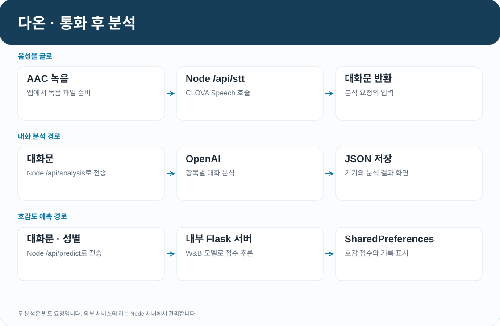

# 다온

영상통화로 먼저 대화하고, 서로 동의하면 사진 공개와 데이트로 이어지는 소개팅 앱입니다. 통화가 끝나면 대화 내용에 대한 피드백과 호감도 예측 결과를 확인할 수 있습니다. Flutter로 앱을 만들고, Node.js 서버와 별도의 Python 모델 서버를 연결했습니다.

[구조](#구조) · [영상통화](#영상통화) · [대화 분석](#대화-분석) · [호감도 모델](#호감도-모델) · [실행](#실행)

## 화면

| 시작 | 회원가입 |
|:---:|:---:|
|  |  |

Flutter 웹 빌드에서 촬영한 화면입니다. 로그인 이후의 매칭·통화·채팅 화면은 Node 서버와 MySQL이 연결된 환경에서 사용할 수 있습니다.

## 구조


앱의 회원 정보와 관계 상태는 Express가 관리하고 MySQL에 저장합니다. Socket.IO는 통화 연결에 필요한 신호와 채팅 메시지를 전달합니다. 영상과 음성은 WebRTC로 두 기기가 직접 주고받습니다.

통화 후 분석은 별도 요청입니다. 앱이 Node 서버에 녹음 파일을 보내면 서버가 CLOVA Speech로 대화문을 얻습니다. 이 대화문을 OpenAI와 Flask 모델 서버에 각각 보내 대화 피드백과 호감 점수를 받습니다. 외부 서비스의 키는 Node 서버에만 둡니다.

| 코드 | 담당 기능 |
|---|---|
| `lib/screens/` | 통화, 분석 결과, 채팅, 데이트 장소, 설정 화면 |
| `lib/services/` | 인증, 시그널링, 얼굴 감지, 분석 결과 저장 |
| `server/server.js` | REST API, Socket.IO, 외부 API 중계 |
| `server/schema.sql` | 회원, 관계 단계, 채팅방과 메시지 테이블 |
| `server/model_server.py` | 호감도 모델 로드와 추론 |

## 영상통화

매칭 요청이 들어오면 접속 중인 사용자 중 상대를 고릅니다. 상대가 없을 때는 대기 목록에 등록합니다. 발신 앱의 offer, 수신 앱의 answer, 양쪽의 ICE candidate를 Socket.IO로 교환한 뒤 WebRTC 연결을 시작합니다.

통화 중 상대 얼굴에는 마스크 이미지를 덮습니다. 상대 영상의 프레임을 `RepaintBoundary`로 0.5초마다 캡처하고, ML Kit가 찾은 얼굴 위치에 오버레이를 그립니다. 이 처리는 기기 안에서 수행합니다.

통화 종료 이벤트가 중복으로 들어와 기록이 늘어나는 것을 막기 위해 서버는 3초 안의 중복 저장을 무시합니다.

## 관계 단계와 채팅

**통화 → 사진 공개 → 데이트** 순서로 진행됩니다. 다음 단계로 넘어가려면 두 사람의 동의가 모두 필요합니다. 한 명이 거절하면 상대 목록에서 삭제됩니다.

사진은 사진 공개 단계부터 조회할 수 있습니다. 데이트 단계에 도달하면 채팅방을 만들고, 해당 방에 참여한 사용자만 메시지를 보내거나 받을 수 있도록 서버에서 확인합니다. 메시지는 `chat_messages`에 저장합니다.

데이트 장소는 두 사람의 위치 중간 지점을 기준으로 찾습니다. 앱이 계산한 좌표를 `/api/date-spots`로 보내면 서버가 TourAPI에서 반경 5km의 장소를 조회합니다.

## 대화 분석



AAC 녹음을 한국어 대화문으로 변환한 뒤, 다음 두 결과를 따로 요청합니다.

- **대화 피드백** — 주제 탐색, 자아 노출, 경청과 협력적 반응을 화자별로 분석합니다. 각 항목의 잘 드러난 부분과 아쉬운 부분을 JSON으로 받아 화면에 표시합니다.
- **호감도 예측** — 대화문과 성별을 모델 서버에 전달해 점수를 얻습니다. 앱에서는 점수에 100을 곱해 호감 지수로 표시합니다.

대화 피드백은 앱 문서 디렉터리의 `analysis_results.json`에, 호감도 기록은 SharedPreferences에 저장합니다. 분석 결과를 서버 DB에 쌓는 구조는 아닙니다.

## 호감도 모델


대화 후 인터뷰에서 드러난 호감 변화에 `0 / 0.5 / 1` 라벨을 부여했습니다. 회귀 실험에서는 이산 라벨만으로 변화의 강도를 표현하기 어려워 발화 임베딩의 유사도와 약한 지도 신호를 이용해 연속 라벨을 만들었습니다.

### 라벨과 회귀 학습

KoBigBird의 CLS 벡터로 발화를 표현하고, Snorkel의 예측과 k-NN 그래프를 이용해 라벨을 전파합니다. 그래프에는 라벨러별 dongle 노드와 `0 / 0.5 / 1` anchor를 둡니다. 전파식은 `F ← (1−μ)PF + μY`이며, 기본 μ는 0.5입니다.

회귀 모델은 아래 순서로 발화별 점수를 계산합니다.

| 모듈 | 처리 |
|---|---|
| `TransformerEmbed` | 현재 발화와 좌우 문맥을 KoBigBird로 인코딩하고, 3·4·5-gram CNN 표현을 더해 100차원으로 투영 |
| 양방향 `GNTB` | 앞에서 뒤로, 뒤에서 앞으로 대화를 읽으며 발화 간 영향을 누적 |
| `TFEModule` | 순·역방향 상태를 LSTMCell과 CNN에 통과시켜 연속 흐름과 지역 패턴을 결합 |
| 회귀 헤드 | TFE 출력과 좌우 발화 표현을 이어 발화별 연속 점수를 출력 |

대화 하나를 배치 하나로 학습합니다. Adam의 학습률은 `1e-5`, 손실은 MSE이며 좌우 문맥이 모두 있는 발화만 손실에 반영합니다. 학습·검증 비율은 80:20이고, 혼합 정밀도와 gradient checkpointing으로 메모리 사용을 줄였습니다.

### 분류 실험과 앱 서빙

호감 상승 여부를 구분하는 모델도 별도로 학습했습니다. 현재 발화와 대화 기록을 최대 4096토큰으로 넣고, KoBigBird의 CLS와 max-pooling 결과를 연결해 이진 분류합니다. 라벨이 0.5를 넘으면 상승으로 처리하며, `BCEWithLogitsLoss`와 AdamW를 사용합니다.

앱의 Flask 서버는 시작할 때 W&B에서 남성·여성 모델 아티팩트를 받아 `AutoModelForSequenceClassification`으로 로드합니다. 이 서빙용 아티팩트를 생성한 학습 코드는 학습 저장소에 포함되어 있지 않습니다. 위 회귀·분류 노트북의 출력과 서빙 아티팩트를 같은 모델로 보아서는 안 됩니다.

### 기록된 결과

| 관점 | 분류 정확도 | 분류 F1 | 회귀 MSE | 회귀 R² |
|---|---:|---:|---:|---:|
| 남성 | 0.607 | 0.756 | 0.056 | 0.587 |
| 여성 | 0.536 | 0.606 | 0.045 | 0.503 |

실사용자 48명의 호감도 예측 기능 만족도는 5점 만점에 4.22점이었습니다. 분류와 회귀의 수치는 서로 다른 실험 결과입니다. 학습 코드는 비공개 저장소 `likeability_expectation`에서 관리합니다.

## 실행

### 1. Node 서버

```bash
git clone https://github.com/cres17/CapstoneDesign.git
cd CapstoneDesign/server
cp .env.example .env
npm ci
```

`.env`에 MySQL 접속 정보와 `JWT_SECRET`, `OPENAI_API_KEY`, `CLOVA_SPEECH_SECRET`, `CLOVA_SPEECH_URL`, `TOUR_API_KEY`를 입력합니다. `server/schema.sql`로 테이블을 준비한 뒤 실행합니다.

```bash
node server.js
```

`JWT_SECRET`은 32자 이상이어야 합니다. 가입과 로그인 외의 API 요청 및 Socket.IO 연결에서는 JWT로 사용자를 확인합니다.

### 2. 모델 서버

저장소 루트에서 실행합니다. W&B 인증과 모델 아티팩트 접근 권한이 필요합니다.

```bash
pip install flask torch transformers wandb
python server/model_server.py
```

기본 주소는 `127.0.0.1:5001`입니다. Node 서버가 `/api/predict` 요청을 중계하며, `MODEL_ARTIFACT_VERSION`으로 사용할 가중치 버전을 고정할 수 있습니다.

### 3. 앱

```bash
flutter pub get
flutter run --dart-define=SERVER_URL=http://<서버-IP>:5000
```

앱에는 서버 주소만 전달합니다. 배포할 때는 HTTPS 주소를 사용합니다.

## 참고

- Li et al., *BiERU: Bidirectional emotional recurrent unit for conversational sentiment analysis*, Neurocomputing 467, 2022.
- Pukdee et al., *Label propagation with weak supervision*, arXiv:2210.03594, 2022.
- Matsuo et al., *Enhancing Impression Change Prediction in Speed Dating Simulations*, arXiv:2502.04706, 2025.
