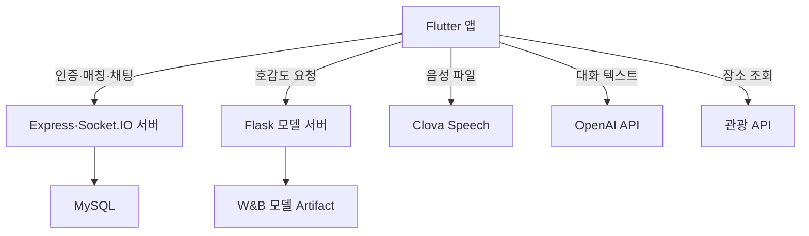

# 다온 — 대화와 호감도 분석 소개팅 앱

Flutter 앱과 Node.js 서버, Python 모델 서버를 함께 사용하는 졸업 프로젝트입니다. 영상통화·얼굴 마스킹·채팅·대화 분석·호감도 예측·장소 추천 관련 코드를 포함합니다.

현재 코드는 실습 환경의 서버 주소와 경로를 포함합니다. 앱 의존성만 설치하면 전체 기능이 바로 연결되는 형태는 아니며, 아래 서버·DB·외부 API 설정이 필요합니다.

## 아키텍처

<picture>
  <source media="(prefers-color-scheme: dark)" srcset="docs/assets/readme/architecture-dark.svg">
  
</picture>

Flutter 앱은 Node 서버에 계정·매칭·채팅을 요청하고, Python 모델 서버에는 호감도 점수를 요청합니다. STT·대화 분석·장소 조회는 별도 외부 API를 사용합니다. 모델 연구 노트북과 현재 서빙 모델의 구성은 아래에서 따로 설명합니다.

| 구성 | 역할 |
|---|---|
| Flutter | WebRTC 통화, 얼굴 마스킹, 녹음, 분석·예측 결과 화면 |
| Node | Express·Socket.IO·MySQL을 통한 인증·매칭·메시지 처리 |
| Python | W&B 모델을 내려받아 Flask /analyze에서 추론 |
| 외부 API | Clova Speech 전사, OpenAI 분석, 관광 장소 조회 |

<details>
<summary>아키텍처 상세와 구현 경계</summary>

### 시스템 구성



영상통화는 앱의 WebRTC 스트림과 서버의 시그널링을 함께 사용합니다. 위 그림은 서비스 연결 관계이며, 별도 통합 배포 구성을 제공한다는 의미는 아닙니다.

</details>

## 기술 스택

<picture>
  <source media="(prefers-color-scheme: dark)" srcset="docs/assets/readme/tech-stack-dark.svg">
  
</picture>

| 영역 | 기술 | 사용처 |
|---|---|---|
| 앱 | Flutter, Dart `^3.7.2` | 모바일 화면과 플랫폼 기능 연결 |
| 상태·로컬 설정 | Provider, shared_preferences | 앱 상태와 로컬 설정 관리 |
| 영상통화 | `flutter_webrtc` `^0.13.1+hotfix.1` | 실시간 영상·음성 스트림 |
| 실시간 통신 | `socket_io_client` `^3.1.2`, 서버 Socket.IO `^4.8.1` | 시그널링·매칭·채팅 이벤트 |
| 얼굴 마스킹 | Google ML Kit Face Detection, Flutter 그리기 | 얼굴 위치 검출과 마스크 표시 코드 |
| 녹음·음성 인식 | FlutterSoundRecorder, Naver Clova Speech | 통화 음성 파일 생성과 STT 요청 |
| 대화 분석 | OpenAI API, `http` | 전사한 대화의 분석 요청 |
| 이미지·UI | image_picker, cached_network_image, flutter_svg, intl | 사진 선택·표시, SVG, 날짜·문자열 표현 |
| 기기 기능 | permission_handler, path_provider | 권한 요청과 파일 경로 |
| 앱 서버 | Node.js, Express `^5.1.0` | 인증·사용자·채팅 관련 HTTP API |
| 인증 | bcryptjs, jsonwebtoken | 비밀번호 해시와 JWT 처리 |
| DB·설정 | MySQL, mysql2, dotenv | 서버 데이터 저장과 환경변수 로드 |
| 모델 서버 | Python, Flask, PyTorch, Transformers | 모델 적재와 호감도 점수 API |
| 모델 관리 | Weights & Biases Artifacts | 관점별 모델 파일 다운로드 |
| 장소 추천 | 한국관광공사 관광 API | 위치 기반 데이트 장소 조회 |

버전은 [pubspec.yaml](pubspec.yaml)과 [server/package.json](server/package.json)의 선언 범위입니다. 얼굴 감지·녹음 등 일부 소스가 사용하는 패키지는 현재 pubspec 선언에서 빠져 있으므로 실행 준비 단계의 의존성 확인이 필요합니다.

## 기능과 구성

| 기능 | 주요 구현 |
|---|---|
| 영상통화와 신호 교환 | flutter_webrtc, Socket.IO |
| 얼굴 감지와 마스크 표시 | Google ML Kit Face Detection, Flutter 그리기 |
| 대화 음성 처리 | 녹음 서비스, Clova Speech 연동 |
| 대화 분석 | OpenAI API 연동 |
| 호감도 점수 요청 | Flutter PredictionService → Python Flask 서버 |
| 로그인·매칭·채팅 | Express, Socket.IO, MySQL 관련 코드 |
| 데이트 장소 | 관광 API 연동 화면과 위치 기반 추천 코드 |

구현 파일이 있다는 것과 실제 기기·서버·API가 연결된 상태에서 검증됐다는 것은 구분해야 합니다. 카메라·마이크·위치 권한과 네트워크 설정도 필요합니다.

## 기능별 구현

### 영상통화와 얼굴 마스킹

`flutter_webrtc`가 영상·음성 통신을 담당하고 [SignalingService](lib/services/signaling_service.dart)가 연결 신호를 교환합니다. [WebRTCFaceDetection](lib/services/webrtc_face_detection.dart)은 화면의 `RepaintBoundary`에서 프레임 이미지를 얻고 ML Kit FaceDetector로 얼굴을 찾는 코드입니다. 검출한 위치는 영상 위 마스크를 배치하는 데 사용합니다.

이 구조는 얼굴 검출과 화면 표시를 앱 쪽에서 수행합니다. 프레임 캡처·임시 이미지 저장·검출 주기가 기기 성능과 화면 좌표에 영향을 받으므로, 실제 영상통화의 마스크 위치와 처리 속도를 함께 확인해야 합니다.

### 음성 인식과 대화 분석

1. [RecorderService](lib/services/recorder_service.dart)가 임시 경로에 `call_record.aac`를 녹음합니다.
2. [ClovaSpeechService](lib/services/clova_speech_service.dart)가 녹음 파일을 Clova Speech에 보내 텍스트를 받습니다.
3. [OpenAIService](lib/services/openai_service.dart)가 대화 텍스트의 분석을 요청합니다.
4. [AnalysisStorageService](lib/services/analysis_storage_service.dart)와 분석 화면에서 결과를 보관·조회합니다.

STT, 외부 LLM 대화 분석, 자체 모델의 호감도 점수는 서로 다른 단계입니다. 각 단계의 입력·응답과 실패 여부를 나누어 확인할 수 있습니다.

### 호감도 변화 예측

[PredictionService](lib/services/prediction_service.dart)가 대화와 관점을 모델 서버에 전달하고, 예측 화면이 결과를 표시합니다. 학습 연구는 Soft Labeling과 KoBigBird 분류·BiERU 회귀를 포함하며, 아래에서 연구 구조와 현재 서버가 실제로 읽는 모델을 구분해 설명합니다.

### 실시간 채팅·매칭·계정

Socket.IO를 이용한 1:1 메시지 교환과 채팅방 처리를 포함합니다. [MatchingService](lib/services/matching_service.dart)는 상대 연결 흐름을, [AuthService](lib/services/auth_service.dart)는 로그인 등 인증 요청을 담당합니다. Node 서버에는 사용자 정보·인증·채팅 관련 MySQL 쿼리가 있습니다.

### 데이트 장소 추천

사용자 위치와 상대방 정보를 활용해 관광 API의 장소를 조회하고 카드 형태로 보여 주는 화면이 있습니다. 실행 환경의 위치 권한·API 설정과 두 사용자의 위치 데이터가 준비되어야 합니다.

## 화면 구성

| 화면 | 제공하는 흐름 | 코드 |
|---|---|---|
| 시작 | 앱 진입과 로그인·회원가입 이동 | [splash](lib/screens/splash) |
| 회원가입·로그인 | 계정과 프로필 정보 입력, 인증 | [auth](lib/screens/auth) |
| 메인 | 상대 연결 및 주요 메뉴 이동 | [main](lib/screens/main) |
| 영상통화 | 영상 스트림과 마스크 표시 | [video_call](lib/screens/video_call) |
| 대화 분석 | 분석 결과 카드와 상세 확인 | [analysis](lib/screens/analysis) |
| 호감도 예측 | 관점별 예측 결과 확인 | [prediction](lib/screens/prediction) |
| 장소 추천 | 위치 기반 추천 장소 카드 | [date_recommendation](lib/screens/date_recommendation) |
| 채팅 | 채팅방과 실시간 메시지 | [chat](lib/screens/chat) |
| 설정 | 사용자 정보와 계정 관련 설정 | [settings](lib/screens/settings) |
| 통화 기록 | 통화 이력 조회 | [call_history_screen.dart](lib/screens/call_history_screen.dart) |

## 학습 모델과 현재 서빙

학습 실험은 [likeability_expectation](https://github.com/cres17/likeability_expectation)에 있습니다. Soft Labeling, KoBigBird 이진 분류, GNTB·CNN·LSTM을 사용하는 BiERU 회귀는 별도의 실험입니다. 하나의 이중 출력 모델로 표현하지 않습니다.

연계 연구의 세부 단계는 다음과 같습니다.

| 단계 | 방법 | 구현 위치 |
|---|---|---|
| 라벨 보완 | KoBigBird 임베딩·코사인 유사도·Snorkel 확률·그래프 라벨 전파 | `likeability_expectation/soft_labeling.ipynb` |
| 상승 여부 분류 | 현재 발화와 문맥 결합, KoBigBird CLS+max-pooling, Linear와 BCE 계열 손실 | `likeability_expectation/raw_code/classification_*.ipynb` |
| 변화 정도 회귀 | 현재·인접 발화 임베딩, 양방향 GNTB, CNN·LSTMCell, Linear와 MSE 손실 | `likeability_expectation/model_train_*.ipynb` |
| 실험 추적 | 손실·평가 지표·가중치 Artifact 기록 | 각 노트북의 W&B 코드 |

분류 실험은 최대 4096토큰을 사용하지만 루트 회귀 노트북의 기본 `MAX_LEN`은 128입니다. 이전의 한 그림 안에서 분류·회귀가 동시에 나온다는 설명 대신, 각 실험의 입력 길이와 출력 목적을 따로 봅니다.

현재 [server/model_server.py](server/model_server.py)의 실제 처리 순서는 다음과 같습니다.

1. W&B에서 `kobigbird-male-mlp-pearson:latest`와 `kobigbird-female-mlp-pearson:latest` 아티팩트를 다운로드합니다.
2. `AutoModelForSequenceClassification`과 `AutoTokenizer`로 적재합니다.
3. `POST /analyze`의 `input_text`와 `gender`를 읽습니다.
4. 입력을 최대 512토큰으로 잘라 추론하고 sigmoid 점수를 `score`로 반환합니다.

이 서버 코드에는 BiERU 클래스를 직접 생성하는 경로가 없습니다. 학습 노트북의 모델을 배포하려면 클래스·가중치 저장 형식·토크나이저가 서버의 적재 방식과 맞는지 확인해야 합니다. W&B의 `latest`가 가리키는 실제 모델 버전도 별도로 고정해야 같은 결과를 재현할 수 있습니다.

### 기존 프로젝트 보고 수치

| 관점 | 분류 정확도 | 분류 F1 | 회귀 MSE | 회귀 R² |
|---|---:|---:|---:|---:|
| 남성 | 0.607 | 0.756 | 0.056 | 0.587 |
| 여성 | 0.536 | 0.606 | 0.045 | 0.503 |

기존 문서의 기록이며 현재 서버를 재실행하여 확인한 성능은 아닙니다. 평가 데이터 분할·실험 설정·모델 아티팩트를 연결해야 배포 모델의 성능과 비교할 수 있습니다. 사용자 48명의 기능 만족도 4.22/5.0 역시 설문 기록이며 모델 정확도와 다른 지표입니다.

## 실행 준비

### 1. 저장소와 Flutter 의존성

`pubspec.yaml`의 Dart 조건은 `^3.7.2`입니다. 이 조건을 지원하는 Flutter와 사용할 플랫폼 SDK를 준비합니다.

```bash
git clone https://github.com/cres17/CapstoneDesign.git
cd CapstoneDesign
flutter pub get
```

현재 소스에는 `google_mlkit_face_detection`, `flutter_sound`, `flutter_dotenv` 등을 import하는 파일이 있지만 이 패키지들은 pubspec의 직접 의존성에 없습니다. 필요한 기능을 실행하기 전에 import와 SDK 호환성을 확인해 누락된 의존성을 선언해야 합니다. `flutter pub get`은 이미 선언된 의존성을 설치하며 누락된 선언까지 보완하지는 않습니다.

기존 프로젝트를 설치할 때 패키지 목록을 다시 `flutter pub add`로 추가할 필요는 없습니다.

### 2. Node.js 서버와 MySQL

Node.js·npm·MySQL을 준비합니다. [server/package.json](server/package.json)의 의존성을 설치합니다.

```bash
cd server
npm install
```

현재 `server.js`는 `multer`를 사용하지만 server/package.json에는 선언되어 있지 않습니다. 서버를 실행하려면 검토한 버전의 multer를 추가로 설치하고 의존성에 반영해야 합니다.

`server/.env`에 아래 환경변수를 설정합니다. 실제 값을 Git에 커밋하지 않습니다.

```dotenv
DB_HOST=127.0.0.1
DB_USER=
DB_PASSWORD=
DB_DATABASE=
JWT_SECRET=
PORT=5000
```

MySQL 데이터베이스와 서버 쿼리에 필요한 테이블을 준비해야 합니다. [capstone_user_database/user.sql](capstone_user_database/user.sql)은 users 테이블 자료이며, [daon/users.sql](daon/users.sql)과 [user_database/user.sql](user_database/user.sql)은 SQL Server 형식입니다. 이 파일들을 모두 MySQL에 실행하는 설치 절차로 취급하면 안 됩니다. 현재 저장소에는 서버 전체 스키마를 한 번에 구성하는 통합 마이그레이션이 없습니다.

프로필 업로드 경로도 `server.js`의 Windows 절대 경로를 실행 환경에 맞는 쓰기 가능한 폴더로 변경해야 합니다. 설정과 필요한 테이블 준비 후 server 폴더에서 실행합니다.

```bash
npm start
```

기본 포트는 5000입니다.

### 3. Python 호감도 모델 서버

별도 터미널에서 server 폴더로 이동한 뒤 가상환경을 준비합니다.

```bash
python3 -m venv .venv
source .venv/bin/activate
python -m pip install torch transformers flask wandb
wandb login
python model_server.py
```

Windows PowerShell의 활성화 명령은 `.venv\Scripts\Activate.ps1`입니다. torch는 사용하는 CPU/CUDA 환경에 맞춰 설치해야 합니다. 위 패키지는 코드의 직접 의존성이며, 검증된 버전 잠금 파일은 현재 없습니다.

W&B 계정에서 코드에 지정된 프로젝트와 두 모델 아티팩트에 접근할 수 있어야 합니다. 아티팩트에는 Hugging Face 로더가 읽을 수 있는 모델·토크나이저 파일이 필요합니다. 접근 권한이나 파일 형식이 맞지 않으면 시작 단계에서 실패합니다. 기본 포트는 5001이며 현재 Flask 실행 설정은 개발용입니다.

요청 형식:

```json
{
  "input_text": "분석할 대화",
  "gender": "male"
}
```

`gender`는 `male` 또는 `female`을 사용합니다.

### 4. 앱 주소와 외부 서비스 연결

- [lib/config/app_config.dart](lib/config/app_config.dart)의 서버 IP·포트를 실제 Node 서버 주소로 바꿉니다.
- [lib/services/prediction_service.dart](lib/services/prediction_service.dart)의 `http://<서버 IP>:5001/analyze`도 실제 모델 서버 주소로 바꿉니다. AppConfig만 수정해도 이 주소가 함께 바뀌지는 않습니다.
- Clova Speech, OpenAI, 관광 API 관련 서비스·화면의 설정을 본인 계정 값으로 확인합니다. 모든 외부 키를 읽는 공통 환경 설정이 마련된 것은 아닙니다.
- 기기에서 서버에 접근할 수 있는지, 카메라·마이크·위치 권한과 플랫폼 네트워크 설정이 맞는지 확인합니다.

그다음 저장소 루트에서 실행합니다.

```bash
flutter run
```

## 주요 경로

| 경로 | 역할 |
|---|---|
| [lib/screens](lib/screens) | 로그인·영상통화·채팅·분석·추천 화면 |
| [lib/services](lib/services) | 음성·분석·예측·인증·통신 서비스 |
| [lib/config/app_config.dart](lib/config/app_config.dart) | 앱의 기본 서버 주소 |
| [server/server.js](server/server.js) | Express·Socket.IO·MySQL 서버 |
| [server/model_server.py](server/model_server.py) | W&B 모델 적재와 Flask 예측 API |
| [pubspec.yaml](pubspec.yaml) | Flutter 의존성과 SDK 조건 |

## 검증 범위

설치 후 로그인·채팅·영상통화·STT·분석·예측을 순서대로 확인해야 합니다. 서버의 `npm test`는 현재 실제 테스트가 아니라 미구현 안내 후 실패하는 명령입니다. 전체 시스템의 자동 통합 테스트나 단일 배포 명령은 제공하지 않습니다.

## 연구 참고 자료

- Pukdee 외, *Label propagation with weak supervision*, arXiv:2210.03594 (2022): 약한 지도 신호와 그래프 라벨 전파 연구.
- Li 외, *BiERU: Bidirectional emotional recurrent unit for conversational sentiment analysis*, Neurocomputing 467 (2022): 양방향 대화 감정 모델 연구.
- Matsuo 외, *Enhancing Impression Change Prediction in Speed Dating Simulations Based on Speakers' Personalities*, arXiv:2502.04706 (2025): 대화에서 인상 변화 예측 연구.
- [호감도 모델 연구 저장소](https://github.com/cres17/likeability_expectation): 학습 노트북과 세부 구조.

## 기여

오류 재현 환경과 관련 화면·서버를 함께 적어 이슈를 등록하거나 Pull Request를 보낼 수 있습니다. 앱 기능, 모델 학습, 모델 서빙 변경은 각각의 실행 경로와 검증 결과를 함께 설명해 주세요.
