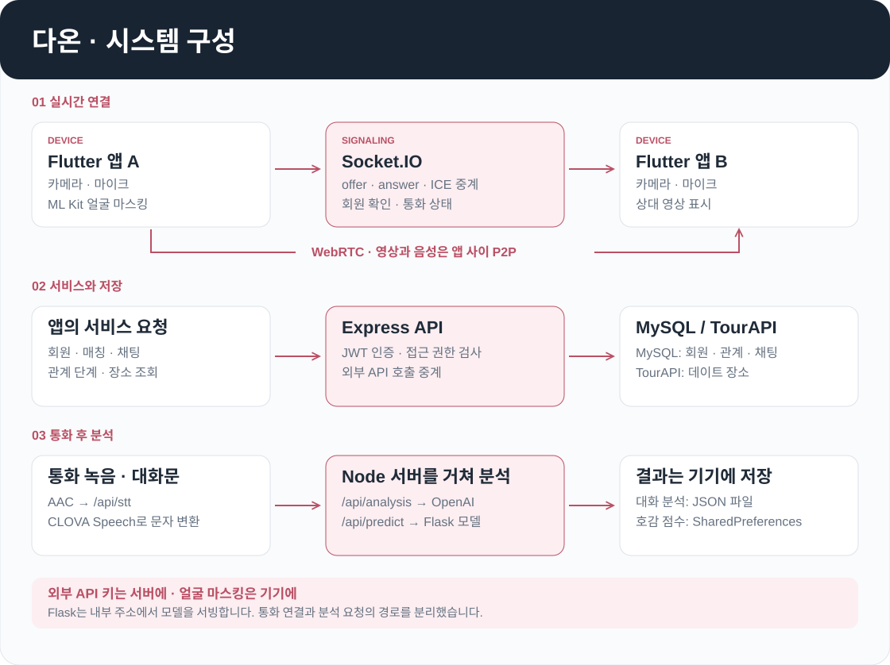
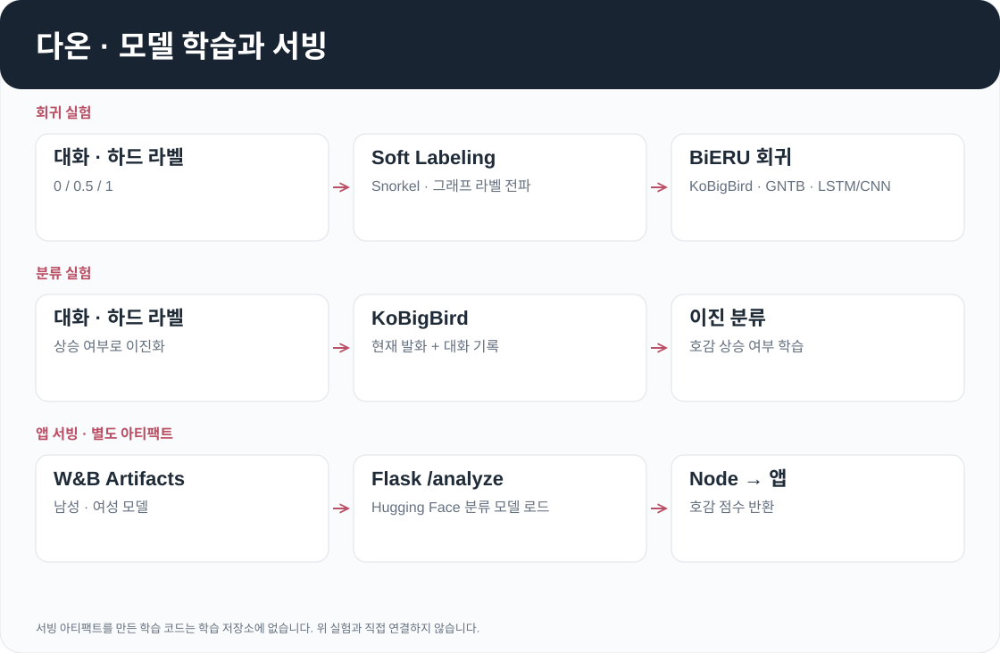
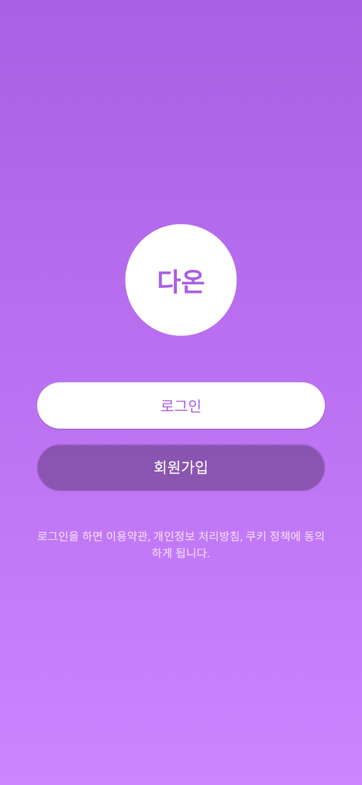
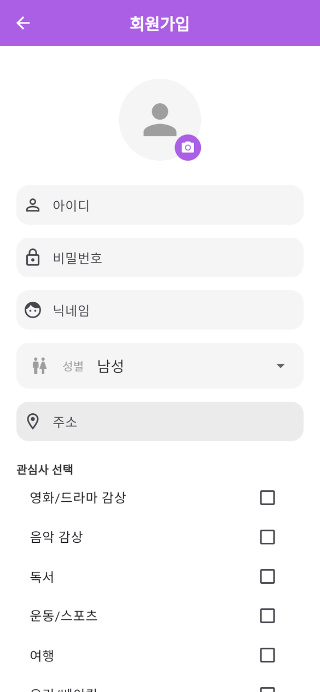

<div align="center">

# 다온 (Daon) - AI 기반 소개팅 어플리케이션


</div>

**다온**은 Flutter 기반의 AI 소개팅 어플리케이션입니다.  
실시간 영상통화, 얼굴 마스킹, AI 대화 분석, **호감도 변화 예측**, 실시간 채팅, 데이트 장소 추천 기능을 제공합니다.

---

## 전체 아키텍처

<p align="center">
  
</p>

| 구간 | 흐름 |
|------|------|
| 회원·매칭 | 앱이 Express REST API로 가입·로그인(bcrypt, JWT 7일)·랜덤 매칭·통화 단계 변경을 요청하고, 서버는 MySQL `users`, `call_partners`에 기록 |
| 영상통화 | 두 앱이 Socket.IO로 offer · answer · ICE candidate를 주고받은 뒤 WebRTC로 직접 영상 연결 |
| 얼굴 마스킹 | 상대 영상을 `RepaintBoundary`로 0.5초마다 캡처 → ML Kit 얼굴 감지 → 얼굴 위치에 마스크 이미지 오버레이 |
| 통화 후 분석 | 녹음 파일(AAC) → CLOVA Speech STT → 대화문을 OpenAI(대화 분석)와 Flask 모델 서버(호감도 점수)에 각각 전송 → 결과를 기기에 저장(대화 분석은 `analysis_results.json` 파일, 호감도 예측은 `SharedPreferences`) |
| 관계 단계 | 1단계 통화 → 양쪽 동의 시 2단계 사진 공개 → 양쪽 동의 시 3단계 데이트, 이때 `chat_rooms` 생성 |
| 채팅 | Socket.IO `joinRoom` · `sendMessage`로 실시간 송수신, 메시지는 MySQL `chat_messages`에 저장 |
| 장소 추천 | 앱이 내 위치(Geolocator)와 상대 위치의 중간 좌표로 TourAPI `locationBasedList1`을 직접 조회 |

---

## 시작하기

**1. 저장소 클론**
```bash
git clone https://github.com/cres17/CapstoneDesign.git
cd CapstoneDesign
```

**2. Node 서버** — `server/.env`에 `DB_HOST`, `DB_USER`, `DB_PASSWORD`, `DB_DATABASE`, `JWT_SECRET` 설정 후
```bash
cd server
npm install
node server.js
```

**3. 모델 서버** — W&B 로그인 후
```bash
pip install flask torch transformers wandb
python server/model_server.py
```

**4. Flutter 앱** — 화면 연결이 끝난 `jmh` 브랜치 기준(`git checkout jmh`). 루트 `.env`에 `OPENAI_API_KEY`, `CLOVA_SPEECH_SECRET`, `CLOVA_SPEECH_URL`을 넣고, `lib/config/app_config.dart`의 `serverIp`를 서버 주소로 변경
```bash
flutter pub get
flutter run
```

---

## 핵심 설계 결정

| 결정 | 방식 | 위치 |
|------|------|------|
| 영상은 P2P, 서버는 시그널링만 | Socket.IO 서버가 offer · answer · ICE candidate만 중계하고, 영상은 WebRTC로 두 앱이 직접 연결합니다. | `server/server.js`, `lib/services/signaling_service.dart` |
| 얼굴 마스킹은 기기에서 처리 | 상대 영상을 `RepaintBoundary`로 0.5초마다 캡처해 ML Kit 얼굴 감지를 돌리고, 얼굴 위치에 마스크 이미지를 덮습니다. | `lib/services/webrtc_face_detection.dart`, `lib/widgets/face_mask_overlay.dart` |
| 관계 단계는 양쪽 동의로만 진행 | 통화 → 사진 공개 → 데이트 단계마다 양쪽 동의가 있어야 `call_partners` 상태가 바뀌고, 3단계에서 `chat_rooms`가 생성됩니다. 거절하면 상대 목록에서 삭제됩니다. | `server/server.js`, `lib/screens/call_history_screen.dart` |
| 분석 · 예측 결과는 기기에 저장 | 대화 분석 결과는 앱 문서 디렉터리의 `analysis_results.json`에, 호감도 예측 결과는 `SharedPreferences`(`prediction_results`)에 최신순으로 저장하고 서버 DB에는 두지 않습니다. | `lib/services/analysis_storage_service.dart`, `prediction_storage_service.dart` (`jmh` 브랜치) |
| 호감도 모델은 별도 서버로 분리 | Flask 모델 서버(포트 5001)가 시작 시 W&B Artifact의 `latest` 가중치를 받아 로드하고, 앱은 `POST /analyze` 점수를 호출합니다. | `server/model_server.py` |

## 주요 기능

### 1. 실시간 영상통화 & 얼굴 마스킹
- **WebRTC**(`flutter_webrtc`)로 실시간 영상통화 구현, 시그널링은 **Socket.IO** 서버가 중계
- **Google ML Kit Face Detection**으로 상대 영상 프레임에서 얼굴 감지
- **CustomPaint**와 **dart:ui**로 얼굴 위치에 마스크 이미지 오버레이
- **RepaintBoundary**로 프레임 캡처, **path_provider**로 임시 파일 저장

---

### 2. AI 기반 대화 분석
- 통화 음성을 `flutter_sound`로 녹음(AAC) → **네이버 CLOVA Speech API**로 STT(음성→텍스트, ko-KR 동기 처리)
- 변환된 대화문을 **OpenAI Chat Completions API**로 전송해 세 기준으로 화자별 평가
  - 적절한 주제 탐색 (협력의 원리, 상호 호혜적 의사소통의 원리)
  - 자아 노출의 적정성 유지 (거리유지의 원칙)
  - 경청과 협력적 반응 (협력의 원리, 공손성의 원리)
- 응답은 항목·화자별 "잘 드러난 부분 / 아쉬운 부분" JSON으로 받아 카드 UI에 표시

---

### 3. 호감도 변화 예측 (Core AI)

소개팅 대화에서 발화자의 **호감도 변화**를 텍스트만으로 예측하는 자체 AI 모델입니다.  
공개 데이터셋이 없는 도메인에서 Weak Supervision 기반 Soft Labeling으로 라벨을 보완하고,  
KoBigBird 발화 인코더, 양방향 GNTB, LSTM/CNN을 결합한 회귀 구조로 대화 전후 맥락을 학습합니다. 학습 코드는 private 저장소 `likeability_expectation`에 있습니다.

#### 성능

| 구분 | 정확도 | F1 | MSE (회귀) | R² (회귀) |
|------|-------|----|-----------|----------|
| 남성 입장 호감도 | 0.607 | 0.756 | 0.056 | 0.587 |
| 여성 입장 호감도 | 0.536 | 0.606 | 0.045 | 0.503 |

> 실사용자 48명 대상 호감도 예측 기능 만족도: **4.22 / 5.0점**

#### 모델 아키텍처

<p align="center">
  
</p>

모델은 네 단계로 나뉩니다. ① Soft Labeling으로 만든 연속 라벨을 ② KoBigBird · GNTB · LSTM/CNN 결합 회귀 모델이 학습하고, ③ 이진 분류 모델은 원래의 하드 라벨로 별도 학습합니다. 분류와 회귀는 하나의 모델에서 나오는 이중 출력이 아니라 서로 다른 노트북의 별도 모델입니다. ④ 앱은 W&B에 올린 모델을 Flask 서버로 서빙해 사용합니다.

**데이터 수집**
- 연애 예능 프로그램 발화 수집 (조건: 남녀 1:1 대화 + 대화 후 인터뷰 호감도 응답)
- 남성 입장 / 여성 입장 각각 `0(하락) / 0.5(유지) / 1(상승)` 하드 레이블 부여

<details>
<summary><b>STEP 1. 라벨 스무딩 (Soft Labeling)</b></summary>


`0 / 0.5 / 1` 이산값만으로는 호감 변화의 강도와 불확실성을 표현하기 어려워, 그래프 기반 라벨 전파로 `[0, 1]` 연속값을 만듭니다. (Pukdee et al., 2022의 weak supervision label propagation 구조)

| 단계 | 함수 | 구현 내용 |
|------|------|----------|
| 발화 분리 | `preprocess_utterances` | `input_text`를 `남:` / `여:` 화자 단위로 나누고, 화자의 **상대 성별 라벨**을 발화별 weak prior로 부여. prior가 0 또는 1이면 hard seed |
| 약한 지도 | `train_label_model` | seed 발화의 투표 행렬로 **Snorkel `LabelModel`**(cardinality 2, 200 epoch)을 학습. seed의 70%만 학습에 쓰고 나머지는 abstain 처리. 확률 분산의 역수로 샘플별 가중치 α 계산 |
| 임베딩 | `get_embeddings` | `monologg/kobigbird-bert-base`의 CLS 벡터 (max_length 256, batch 8) |
| 그래프 | `build_graph_with_dongles` | 코사인 유사도 `(cos+1)/2`로 k-NN(k=50) 연결. 레이블러별 dongle 노드(0·1)와 anchor 노드(0 · 0.5 · 1)를 추가하고 행 정규화 |
| 전파 | `label_propagation` | `F ← (1−μ)·P·F + μ·Y`, μ=0.5, 변화량 1e-4 미만 또는 100회에서 종료 |
| 저장 | `save_soft_labels_dual` | 발화별 `soft_label_male`, `soft_label_female`을 JSONL로 저장 |

```python
# label_propagation: 고정점 반복
F = Y.copy()
for _ in range(MAX_ITER):
    F_new = (1 - mu) * (P @ F) + mu * Y
    if np.linalg.norm(F_new - F) < EPSILON:
        break
    F = F_new
```

```
Before:  0 ████  0.5 ██  1 ████   (3점 집중 이산 분포)
After:   ░▒▓█████▓▒░▒▓██████▓░   (다봉 연속 분포)
```

</details>

<details>
<summary><b>STEP 2. KoBigBird · GNTB · LSTM/CNN 결합 회귀 — 대화 전후 맥락 학습</b></summary>


세 부분을 차례로 결합한 구조입니다. ① **KoBigBird**가 현재 발화와 좌·우 문맥 발화를 인코딩하고 n-gram CNN으로 지역 표현을 더해 100차원 벡터로 만듭니다. ② **GNTB**(Generalized Neural Tensor Block)를 대화 순서대로 순방향·역방향으로 적용해 앞뒤 발화의 영향을 상태로 누적합니다. 양방향 GNTB 적용 방식은 BiERU(Li et al., 2022)를 참고했습니다. ③ 순·역방향 상태를 **LSTM**(연속 감정 흐름)과 **CNN**(지역 패턴)에 통과시킨 뒤 회귀 헤드가 발화별 점수를 냅니다. 구현은 `BiERULocal` 클래스입니다.

| 모듈 | 입력 → 출력 | 구현 내용 |
|------|------------|----------|
| `DialogueDataset` | 대화 1개 = 배치 1개 | `dialogue_id`로 발화를 묶고 현재 발화와 `context_left`, `context_right`를 각각 토큰화 (MAX_LEN 128) |
| `TransformerEmbed` | 토큰 → 100차원 | KoBigBird 출력에 3·4·5-gram Conv1d(각 50채널) + max-pool, CLS 투영 + CNN adapter를 더해 평균 (gradient checkpointing 사용) |
| `GNTB` | (이전 상태 100 ⊕ 발화 100) → 100 | slice 100개마다 저랭크 텐서 `m·(U·V)·mᵀ` (rank 10) + 대각항 + 선형항 + bias, tanh |
| 양방향 순환 | 발화 시퀀스 | 같은 GNTB로 첫 발화부터 순방향, 마지막 발화부터 역방향 상태를 계산 |
| `TFEModule` | 200 → 200 | 순·역방향 상태를 이어 LSTMCell(연속 감정 흐름)과 Conv1d 200채널(지역 패턴)에 통과시킨 뒤 투영 |
| 회귀 헤드 | 400 → 1 | `[TFE 출력, 좌 발화 임베딩, 우 발화 임베딩]` → tanh → Linear |

```python
# BiERULocal.forward 요약
fwd = [gntb(None, uc[0])]
for t in range(1, T):
    fwd.append(gntb(fwd[-1], uc[t]))           # 순방향
bwd = [gntb(None, uc[-1])]
for t in reversed(range(T - 1)):
    bwd.insert(0, gntb(bwd[0], uc[t]))         # 역방향

for t in range(T):
    p_fb, (h, c) = tfe(torch.cat([fwd[t], bwd[t]], dim=1), (h, c))
    p_cat = torch.tanh(torch.cat([p_fb, ul[t], ur[t]], dim=1))
    preds.append(reg(p_cat).squeeze(-1))       # 발화별 점수
```

| 학습 설정 | 값 |
|-----------|----|
| 손실 | `MSELoss` — 좌·우 문맥이 모두 있는 발화만 반영 |
| 옵티마이저 | Adam, lr 1e-5, weight decay 1e-3, `ReduceLROnPlateau`(factor 0.5, patience 1) |
| 기타 | batch 1(대화 단위), epoch 10, dropout 0.5, AMP(`autocast`, `GradScaler`), 학습/검증 80:20 |
| 평가·기록 | MSE, MAE, Pearson 상관, W&B Artifact(`bieru-model-soft_label-*`) |

</details>

<details>
<summary><b>STEP 3. 이진 분류 — 호감 상승 여부</b></summary>


```python
class KoBigBirdBinaryClassifier(nn.Module):
    def __init__(self):
        super().__init__()
        self.encoder = AutoModel.from_pretrained("monologg/kobigbird-bert-base")
        hidden = self.encoder.config.hidden_size
        self.classifier = nn.Linear(hidden * 2, 1)

    def forward(self, input_ids, attention_mask):
        outputs = self.encoder(input_ids=input_ids, attention_mask=attention_mask)
        cls_emb = outputs.last_hidden_state[:, 0, :]
        pooled  = torch.max(outputs.last_hidden_state, dim=1).values
        combined = torch.cat([cls_emb, pooled], dim=-1)
        return self.classifier(combined).squeeze(-1)
```

- 입력: `target_utterance + " [SEP] " + dialogue_history`, KoBigBird의 긴 입력을 활용해 MAX_LEN 4096
- 라벨: 관점별 하드 라벨이 0.5 초과면 1 (상승), 나머지 0
- 학습: `BCEWithLogitsLoss`, AdamW lr 2e-5, batch 4, epoch 10, 학습/평가 80:20 (`random_state=42`)
- 평가: sigmoid 후 0.5 임계값으로 Accuracy · F1 · 혼동행렬

</details>

<details>
<summary><b>STEP 4. 모델 서빙</b></summary>


- 학습한 가중치를 **W&B Artifacts**로 버전 관리
- `server/model_server.py`(Flask, 포트 5001)가 시작 시 `kobigbird-male-mlp-pearson`, `kobigbird-female-mlp-pearson`의 `latest` 아티팩트를 받아 `AutoModelForSequenceClassification`으로 로드
- `POST /analyze` `{ input_text, gender }` → 성별에 맞는 모델로 추론(max_length 512) → sigmoid 점수 `{ score }` 반환
- 앱은 점수 × 100을 "호감 지수"로 표시

> 서빙 아티팩트는 Hugging Face 분류 모델 형식이며, 이를 만든 학습 노트북은 `likeability_expectation` 저장소에 포함되어 있지 않습니다. 위 STEP 2·3의 노트북은 `state_dict`를 저장합니다.

</details>

> 참고: Li, Wei, et al. *"BiERU: Bidirectional emotional recurrent unit for conversational sentiment analysis."* Neurocomputing 467 (2022)  
> 참고: Pukdee, Rattana, et al. *"Label propagation with weak supervision."* arXiv:2210.03594 (2022)  
> 참고: Matsuo, Kazuya, et al. *"Enhancing Impression Change Prediction in Speed Dating Simulations."* arXiv:2502.04706 (2025)

---

### 4. 실시간 채팅 기능
- **Socket.IO** 기반의 1:1 채팅 및 채팅방 목록
- 3단계(데이트)에 양쪽이 동의하면 서버가 채팅방을 생성
- 메시지 실시간 송수신(`joinRoom`, `sendMessage`, `receiveMessage`), 대화 기록은 MySQL에 저장

---

### 5. 데이트 장소 추천
- 내 현재 위치(Geolocator)와 선택한 상대방 위치의 **중간 좌표**를 계산
- **한국관광공사 TourAPI**(`KorService1/locationBasedList1`)로 반경 5km 내 장소 조회, 카드형 UI로 제공

---

### 6. 기타 기능
- **회원가입/로그인**: 아이디·닉네임 중복 확인, bcrypt 비밀번호 해시, JWT 발급
- **랜덤 매칭**: 서버에 접속한 사용자 중 무작위 연결, 없으면 대기 목록에 등록
- **관계 단계**: 통화 → 사진 공개 → 데이트, 각 단계는 양쪽 동의가 모두 있어야 진행. 거절하면 상대 목록에서 삭제
- **대화 분석/예측 결과 조회**: 카드형 UI, 상세 화면
- **설정**: 주소 수정, 로그아웃, 회원탈퇴

---

---

## 화면 구성

| 화면 | 내용 |
|------|------|
| 시작 · 로그인 · 회원가입 | 앱 소개, 아이디 · 비밀번호 로그인, 성별 · 주소 · 닉네임 · 프로필 사진 입력 |
| 메인 | 하단 내비게이션(메인, 데이트 장소 추천, 채팅방, 설정), 상대방 연결 버튼, 상단 내비게이션(대화 분석, 예측 결과) |
| 영상통화 | 얼굴 마스킹이 적용된 영상통화 |
| 대화 분석 · 호감도 예측 | 통화별 결과 카드와 상세 화면 |
| 데이트 장소 추천 | 두 사람의 위치 기반 추천 장소 카드 |
| 채팅방 | 1:1 채팅, 채팅방 목록, 실시간 메시지 |
| 설정 | 주소 수정, 로그아웃, 회원탈퇴 |

| 시작 | 회원가입 |
|:----:|:--------:|
|  |  |

`mjs` 브랜치를 Flutter 웹으로 빌드해 촬영했습니다. 로그인 이후 화면(매칭, 영상통화, 분석, 채팅)은 MySQL과 Node 서버(`server/server.js`)가 있어야 하므로 이 두 화면만 실었습니다.
